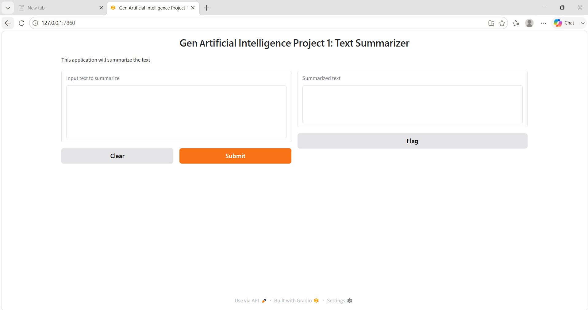
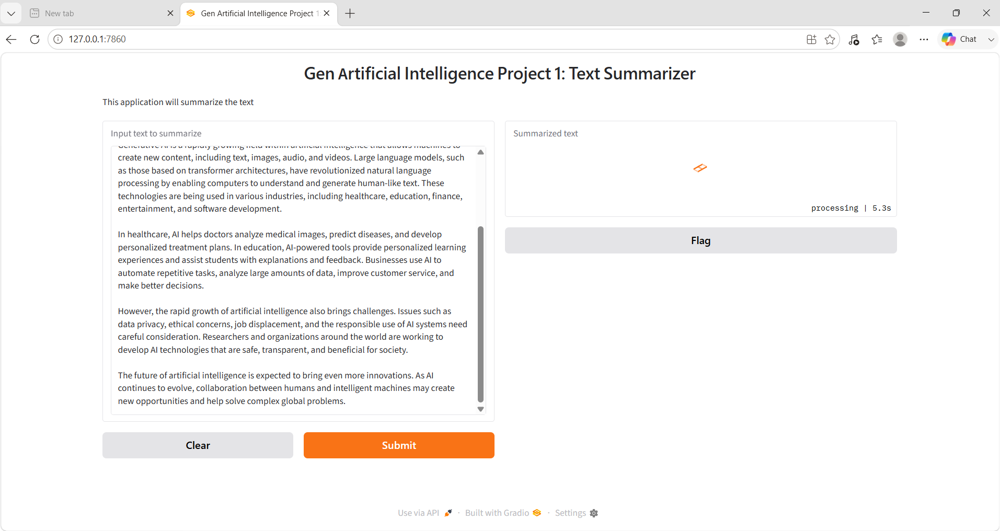
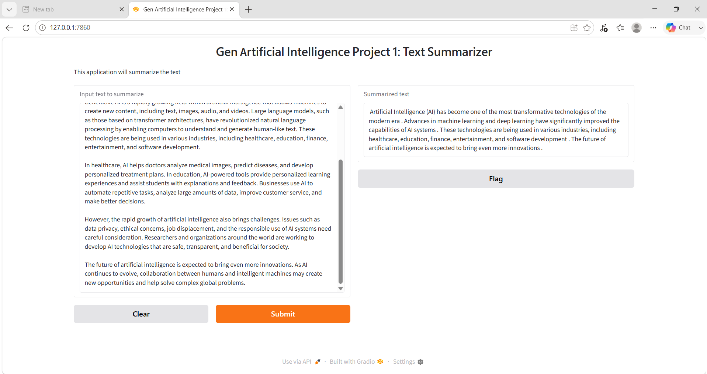

# Text Summarizer using Generative AI

A simple AI-powered Text Summarization application built using Python, Hugging Face Transformers, PyTorch, and Gradio. It takes lengthy text as input and generates a shorter, meaningful summary while preserving the key information.

## Features

- Summarizes long text into concise and meaningful summaries.
- Uses the pre-trained DistilBART CNN model.
- Provides an interactive web interface using Gradio.
- Runs locally using a downloaded model.
- Simple and easy-to-use interface.

## Technologies Used

- **Python** – Core programming language
- **Hugging Face Transformers** – For loading and using the summarization model
- **DistilBART (distilbart-cnn-12-6)** – Pre-trained text summarization model
- **PyTorch** – Deep learning framework
- **Gradio** – Interactive web interface

## Model Information

This project uses the pre-trained **DistilBART CNN (sshleifer/distilbart-cnn-12-6)** model for abstractive text summarization.

The model is loaded locally using the Hugging Face Transformers pipeline with the `summarization` task.

## How It Works

1. The user enters a block of text into the Gradio interface.
2. The input text is passed to the summarization function.
3. The Transformers pipeline processes the text using the pre-trained DistilBART model.
4. The model generates a concise summary.
5. The summarized text is displayed in the output textbox.

## Project Structure

```text
Text-Summarizer-GenAI/
│
├── Screenshots/
│   ├── PROJECT1.1.png
│   ├── PROJECT1.2.png
│   └── PROJECT1.3.png
│
├── .gitignore
├── README.md
├── requirements.txt
└── textsummary.py
```

## Installation and Setup

### 1. Clone the Repository

```bash
git clone https://github.com/shruti18sk/Text-Summarizer-GenAI.git
cd Text-Summarizer-GenAI
```

### 2. Create a Virtual Environment

```bash
python -m venv .venv
```

Activate the environment:

**Windows:**
```bash
.venv\Scripts\activate
```

### 3. Install Dependencies

```bash
pip install -r requirements.txt
```

### 4. Download the Model

Download the `sshleifer/distilbart-cnn-12-6` model from Hugging Face and place its model files in the local directory expected by `model_path` in `textsummary.py`.

### 5. Run the Application

```bash
python textsummary.py
```

Gradio will launch the application locally and provide a URL to access the interface.

## Screenshots

### Application Interface



### Text Input



### Generated Summary



## Requirements

- Python
- PyTorch
- Transformers
- SentencePiece
- Gradio
